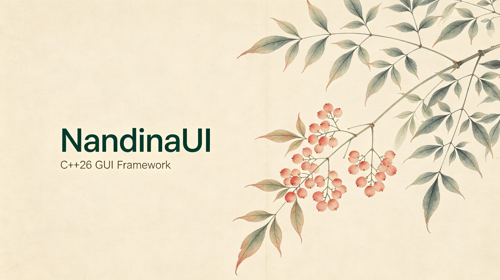
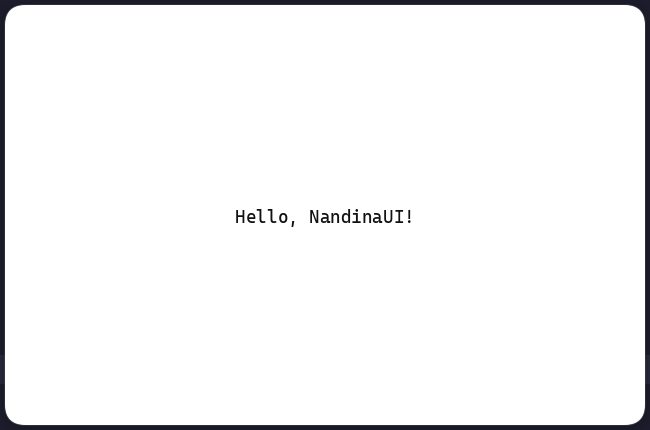

<div align="center">

# NandinaUI · 南天竹

**一个面向 Linux 桌面的 C++26 GUI 框架 —— 让编写桌面应用成为一件舒服的事。**

[](LICENSE)
[](release-metadata.toml)
[]()
[](https://github.com/CvRain/NandinaUI/actions/workflows/ci.yml)

</div>

## 简介

NandinaUI（南天竹）是一个用 **C++26** 编写、基于 **Meson** 构建的原生桌面 UI 框架。它以 C++ 控件和场景树为基础，提供声明式界面构建、响应式状态、主题、动画、资源管理与页面导航，让应用代码可以用类型安全的 DSL 组织桌面界面，同时保留直接访问控件对象的能力。

项目在开发时参考了现有主流框架的设计思路，如 `Angular` 的页面调度与响应式机制、`Shadcn` 的 primitives + token 组件设计、`Slint` 的脏数据更新与文件渲染机制、`Qt` 的新信号槽机制与组件 API 设计。

> 当前处于 **alpha** 阶段，正式支持范围为 `linux-desktop-source` profile（Linux 桌面源码集成）。API 仍在快速演进；项目不承诺保留旧公开头文件或命名空间的源码兼容入口。

## 项目速览

| 项目 | 信息 |
| --- | --- |
| 定位 | 面向 Linux 桌面应用的原生 C++ UI 框架 |
| 语言 / 标准 | C++，`cpp_std=c++26` |
| 构建系统 | Meson（第三方库经 CMake subproject 适配） |
| 许可证 | MIT（Copyright © 2026 ClaudeRainer） |
| 版本 | 0.1.0-alpha.1 |

## ✨ 核心特性

- **声明式 UI DSL** —— 用 `ui.column()`、`ui.center()`、`ui.make<widget::Button>()` 组合出可读的界面树，布局、对齐、间距一链式完成。
- **响应式状态** —— `signal` / `computed` / `effect` / `property` / `batch`，状态变化自动驱动界面更新，告别手动刷新。
- **可组合组件库** —— 覆盖内容展示、输入选择、布局滚动、浮层反馈与通用指针手势，并通过统一主题和声明式构建器组合。
- **动画系统** —— 值级 Tween、Spring、关键帧与缓动曲线；节点表现层支持 opacity、translate、scale 等 L2 属性动画，同一节点的扁平 Tween 组合提供实验性作者入口。跨节点组合、组内 Spring 与关键帧作者入口尚未开放。
- **现代文本引擎** —— FreeType + HarfBuzz + FriBidi + utf8proc 组成的字形管线，支持多字体、系统字体发现、复杂文字整形与双向文本。
- **主题与设计系统** —— 三层设计令牌（primitive → semantic → component）、明暗外观（Appearance）、内置主题与样式文档。默认主题对齐 shadcn 的语义角色集，开箱即用；对比度与层级由测试守住。
- **资源系统** —— 资源清单（manifest）+ 内置/目录/内存/SQLite 四类后端，配合 `nanres` 编译器与可移植打包流程。
- **应用运行时** —— 窗口、Router/Page 导航、视口缩放、异步作用域与统一的输入/剪贴板分发。
- **可选 2D 物理** —— 基于 Box2D 3.x 的轻量物理桥（默认关闭）。
- **无障碍语义** —— 控件语义树导出，为可访问性工具铺路。

资源构建已有 helper 和脚手架自动化，但 `nanres` 目前仍链接完整框架，SQLite 尚无工具/后端
独立关闭选项。[D5 资源构建与部署](docs/references/resource_build_and_deployment.md) 已冻结设计，
将分批补齐工具解耦、运行时查询作用域、身份生成及声明式构建/安装定位；这些能力尚未实施。

## 🧱 架构

框架按模块组织：

| 模块 | 职责 |
| --- | --- |
| `foundation` | 颜色、几何、布局约束、纯值 motion、UTF-8、JSON、日志 |
| `reactive` | 信号图、computed/effect、属性绑定 |
| `resource` | 资源清单、多后端、运行时管理 |
| `physics2d` | 可选 Box2D 物理桥（默认关闭） |
| `theme` | 设计令牌、主题管理器、样式文档 |
| `render` | SDL3 渲染设备、共享图片解码、纹理缓存、SDF 图元 |
| `text` | 字体加载、字形图集、复杂文本整形 |
| `scene` | 场景树、节点、控件、表现层、动画宿主与帧调度 |
| `semantics` | 无障碍语义 |
| `widget` | 组件库、声明式 DSL、布局原语 |
| `app` | 窗口、Router/Page、应用入口 |

## 🧩 组件支持

| 类别 | 当前可用 |
| --- | --- |
| 内容与展示 | Label、Image、Avatar（首字母占位）、Badge、Chip、Divider、ProgressBar、Spinner、Skeleton、EmptyState、Card |
| 输入与选择 | Button、Checkbox、Switch、RadioButton/RadioGroup、Slider、TextField、TextArea、Select、Combobox、Tabs、Toggle、ToggleGroup、ButtonGroup、Breadcrumb、Pagination |
| 浮层与反馈 | Dialog、AlertDialog、Popover、DropdownMenu、ContextMenu、CommandPalette、HoverCard、Tooltip、Alert |
| 交互扩展 | PointerArea、GestureArea（实验性） |
| 布局与滚动 | Column、Row、Flex、FlexItem、Wrap、Stack、Padding、Center、Expanded、Grid、ScrollView、ListView |

表中前四类共 37 个公开组件（`RadioGroup` 与 `RadioButton` 同行记录）；"布局与滚动"一栏是声明式布局原语，不计入组件数。完整的用途、成熟度与计划组件见 [组件参考](docs/components/README.md)。

当前布局以 Column、Row、Flex、Grid 等排列容器为主。场景树 anchors 已落地 scene 内核（`NodeRef<T>`、`AnchorCanvas`、`set_anchors`）与作者入口（`ui.ref<T>()`、`ui.anchor_canvas()`、builder 的 `.anchor.*` / `.parent.anchor.*` 与 `.anchors(...)`），支持父级/兄弟关系、依赖排序、批量关系切换与冲突诊断；`showcase` 的 `anchors` 页面提供侧边栏停靠切换案例。当前边界是**画布需要确定尺寸，因此 `fill` 画布无法占据排列容器的剩余空间**（显式/百分比尺寸的画布可以嵌入排列容器），把画布放在布局根再用兄弟锚点表达剩余区域即可，见 [Anchors](docs/references/anchors.md)。它与浮层锚定定位器是两项独立能力。

## 🚀 快速开始

### 环境要求

- **Linux 桌面**（Wayland | Xorg）——**正式支持范围**
- **Windows**：实验性构建，见下文“在 Windows 上构建”；不在正式支持范围
- **macOS**：**不在支持范围**（无硬件、无测试环境，不提供构建或运行承诺）
- **编译器**：GCC ≥ 16 或 Clang ≥ 21（需 C++26 支持）
- **构建工具**：Meson、Ninja、CMake、pkg-config、Python 3
- **系统库**：OpenSSL ≥ 3.0，以及所选 SDL3 窗口系统与渲染驱动的依赖

其余第三方依赖（spdlog、FreeType、HarfBuzz、FriBidi、utf8proc、toml++、nlohmann/json、Catch2、Box2D、SDL3）以 **`wrap-git` + 完整 commit pin** 提供，默认 `vendored` 来源；SQLite 以官方 amalgamation 直接随源码分发（见 `third_party/sqlite3/README.md`），不需要系统安装。仓库里只剩字体数据包（`caskaydia-cove`）是 submodule，所以 `git clone --recursive` 只用于取它；其余依赖由首次 `meson setup` 或 `meson subprojects download` 拉取。

> 想完全离线构建：先 `meson subprojects download` 预热，再用 `--wrap-mode=nodownload` 配置。
> 依赖级三态开关是 `-Dsdl3_source=auto|system|vendored`（默认 `vendored`），解析结果会写进
> `build/deps.json`。权威规则见[第三方依赖策略](docs/references/dependency_policy.md)；
> SDL3 作为默认窗口/渲染后端的版本下限（≥ 3.4.0，`SDL_GPURenderState`）也记在那里。

raylib 已完整退出源码和依赖闭包，不提供 `raylib_backend` 开关。
默认 `sdl_backend=enabled`、vendored SDL3 静态链接；`-Dsdl3_linkage=shared` 可选共享模式。
静态 SDL3 只免除 SDL3 自身的 DSO 分发，不表示系统运行库或图形驱动也静态打包。
无窗口后端构建使用 `-Dsdl_backend=disabled -Dshowcase=false`；打开窗口须自行注入平台。
未追踪的本地 playground 仅在 `-Dplayground=true` 时构建；旧 raylib bench 已从本地目标移除，源码保留作历史记录。

资源工具可独立于 UI 构建：

```bash
meson setup build-resources --wrap-mode=nodownload -Dbuild_ui=false
meson compile -C build-resources nanres
```

此配置不查找 SDL 或字体引擎；需预热 toml++，默认开启测试时还需 Catch2。
`resource_tools=false` 关闭本地工具及其 OpenSSL 依赖；`resource_sqlite=disabled` 只关闭
运行时 SQLite 后端，打包工具仍可使用 SQLite。两者同时关闭时不构建 SQLite，仍可运行
内存/目录/内置资源后端。`resource_sqlite=auto` 在当前 vendored 策略下等价于 enabled。
纯资源配置自动排除 showcase、playground 和窗口探针；`examples` 默认 false，应用示例在
P2.4 实现前显式开启会报错。启动默认不开包及外部工具握手尚属 P2.1b，未在本批改变。

### 在 Debian / Ubuntu 上准备环境

发行版自带的编译器通常达不到上面的版本要求，所以分四步：装系统库、装合规工具链、装 Meson、再配置构建。

**1. 系统库**（X11 后端，与 CI 同源的开发环境清单）

```bash
sudo apt-get update
sudo apt-get install -y --no-install-recommends \
  git ca-certificates curl python3 python3-pip ninja-build pkg-config cmake \
  zlib1g-dev libssl-dev \
  libx11-dev libxrandr-dev libxinerama-dev libxcursor-dev libxi-dev \
  libgl1-mesa-dev libglu1-mesa-dev
```

这份清单保留 OpenGL/GLU 开发包；raylib 退役后的最小容器依赖尚未复验，因此不将其视为最小必需集合。

Wayland 开发需要 `libwayland-dev libxkbcommon-dev wayland-protocols libdecor-0-dev`。`linux_window_system=auto` 交给 vendored SDL3 探测可用驱动；可显式用 `-Dlinux_window_system=x11` 或 `wayland` 限制构建的窗口系统。

`zstd` 只有 SDK 打包与全量测试套件需要，构建框架本身不需要。

**2. C++26 工具链**

| 发行版 | 仓库内最高版本 | 做法 |
| --- | --- | --- |
| Debian 13 trixie | gcc-14 / clang-19 | 都低于要求 → 用 apt.llvm.org 装 clang-21，或改用 sid |
| Debian sid | gcc-16 / clang-22 | `sudo apt-get install -y g++-16`（或 `clang-21` / `clang-22`） |
| Ubuntu 24.04 LTS | gcc-14 / clang-18 | 都低于要求 → 用 apt.llvm.org 装 clang-21 |
| Ubuntu 25.10 questing | gcc-15 / clang-21 | GCC 不够、Clang 够 → `sudo apt-get install -y clang-21` |
| Ubuntu 26.04 resolute | gcc-16 / clang-21 | `sudo apt-get install -y g++-16` |

走 LLVM 官方仓库装 Clang 21：

```bash
curl -fsSL -o llvm.sh https://apt.llvm.org/llvm.sh && chmod +x llvm.sh
sudo ./llvm.sh 21
```

Clang 链接系统自带的 libstdc++；Debian 13 与 Ubuntu 24.04 提供的是 GCC 14 的版本，与 CI 的 Clang 任务相同。若发行版更旧（libstdc++ 低于 GCC 14），需要先补一个新的 `libstdc++-*-dev`，否则会缺 C++26 库特性。

**3. Meson**

CI 固定 1.7.2。Debian 13 自带的 1.7.0 与之接近；Ubuntu 24.04 自带的 1.3.2 差距较大，建议装一份与 CI 一致的（`pip install --user` 从 Ubuntu 24.04 起会被 PEP 668 拒绝，所以用 pipx）：

```bash
sudo apt-get install -y meson                                  # 自带版本够新时
sudo apt-get install -y pipx && pipx install "meson==1.7.2"    # 或：与 CI 对齐
```

**4. 配置与构建**

版本化的编译器不是默认的 `gcc` / `clang`，要把 `CC` / `CXX` 指过去；Meson 只在首次配置时读取它们。项目同时需要 C 与 C++ 编译器，因为随源码分发的 SQLite amalgamation 是 C 源码：

```bash
CC=clang-21 CXX=clang++-21 meson setup buildDir --wrap-mode=nodownload
# GCC 组合换成：CC=gcc-16 CXX=g++-16
meson compile -C buildDir
```

把 NandinaUI 作为 subproject 引入时同理：在消费项目**首次** `meson setup` 之前设好 `CC` / `CXX`，否则 Meson 会把发行版默认编译器固化进缓存。

### 在 Fedora 上准备环境

Fedora 比 Debian/Ubuntu 省事：仓库自带的编译器通常已经够新，Meson 也无须额外安装。

**1. 系统库**

```bash
sudo dnf install -y \
  git python3 ninja-build cmake pkgconf-pkg-config \
  zlib-ng-compat-devel openssl-devel \
  libX11-devel libXrandr-devel libXinerama-devel libXcursor-devel libXi-devel \
  mesa-libGL-devel mesa-libGLU-devel
```

Wayland 会话还需要 `wayland-devel libxkbcommon-devel wayland-protocols-devel libdecor-devel mesa-libEGL-devel`；`linux_window_system=auto` 的取舍与上面 Debian 一节相同。

注意 zlib 自 Fedora 40 起已由 zlib-ng 提供，`zlib-devel` 不再存在，开发头文件在 `zlib-ng-compat-devel`。`zstd` 同样只服务 SDK 打包与全量测试套件。

**2. 工具链与 Meson**

| Fedora | 默认 gcc / g++ | 默认 clang | 自带 Meson |
| --- | --- | --- | --- |
| 43 | 15.3（低于要求） | 21.1 ✓ | 1.8.5 |
| 44 | 16.0 ✓ | 22.1 ✓ | 1.11.2 |
| rawhide | 16.2 ✓ | 23.1 ✓ | 1.12.1 |

Fedora 44 及以上直接用默认组合：

```bash
sudo dnf install -y gcc gcc-c++ meson
```

Fedora 43 的默认 GCC 只有 15，达不到要求，但它自带 Clang 21，改用 Clang：

```bash
sudo dnf install -y clang meson
```

Fedora 另外提供带版本号的兼容包（如 `gcc15`、`clang21`）。注意包名不带连字符，与 Debian 的 `gcc-15` / `clang-21` 写法相反。

**3. 配置与构建**

```bash
# Fedora 44+：默认 gcc / g++ 已合规
meson setup buildDir --wrap-mode=nodownload

# Fedora 43：默认 GCC 15 不够，显式指向 Clang
CC=clang CXX=clang++ meson setup buildDir --wrap-mode=nodownload

meson compile -C buildDir
```

与 Debian 一节同理：项目同时需要 C 与 C++ 编译器（随源码分发的 SQLite amalgamation 是 C 源码），作为 subproject 引入时 `CC` / `CXX` 要在消费项目**首次** `meson setup` 之前设好。

### 在 Windows 上构建（实验性，非支持范围）

Windows 构建目前做到“能配置、能编译、能跑单元测试”的探索阶段，**没有**完整的回归验收；
问题请按实验性支持对待。目前**实测可用**的组合是 MSYS2 UCRT64 工具链（GCC 16.2 + Meson 1.12.1），
clang-cl / MSVC 未验证（项目要求 C++26，MSVC 的语言特性覆盖不足以作为承诺）。

在 **MSYS2 UCRT64** 终端里：

```bash
pacman -S --needed mingw-w64-ucrt-x86_64-{gcc,cmake,ninja,pkgconf,openssl,git,zlib}
pacman -S --needed mingw-w64-ucrt-x86_64-python
python -m pip install meson
meson setup buildDir --buildtype=release
meson compile -C buildDir
meson test -C buildDir --suite unit
```

> **远程/非交互构建（SSH、CI）**：先 `$env:PATH = 'C:\msys64\ucrt64\bin;' + $env:PATH`。
> 否则 `cc1plus.exe`/`ld.exe` 找不到同目录的 DLL，编译/链接会**静默**退出 1（没有任何报错），
> 表现为 CMake 子项目报 "compiler is not able to compile a simple test program"。
> 2026-10-20 已在真机上验证：release 构建通过、`meson test --suite unit` 80/80、showcase 可运行、DXIL 设备级验收通过。

构建完成后，Windows 运行时 DLL（`libstdc++-6`、`libgcc_s_seh-1`、`libwinpthread-1`、zlib/bz2/png/brotli、
以及共享模式的 SDL3 DLL）会被自动复制到每个可执行文件旁边（`windows-runtime-dlls` 构建步骤），
所以可以直接运行：

```powershell
.\buildDir\showcase\nandina_showcase.exe
.\buildDir\tests\sdf_device_test.exe --require-gpu --expect-format dxil
```

默认 vendored 静态 SDL3 不复制 SDL3 DLL，也不会提示“共享库尚未生成”。system SDL3
会按编译器目录/PATH 查找 DLL；找不到时明确提示核对链接方式与运行时分发，不能据此声称已打包完整。
当前程序使用普通 `main`，未包含 `SDL_main.h`；固定版本 SDL3 已不使用 SDL2 的 SDLmain 静态库，
不额外手写 `-lmingw32` / SDLmain 链接顺序。Windows 静态完整构建仍需真机验收。

窗口测试默认 auto：无显示或原生窗口无法创建时记录为 **SKIP**。SSH/session 0 可设置
`$env:NANDINA_SKIP_WINDOW_TESTS='1'` 显式跳过；本地桌面验收用 `-Dwindow_tests=enabled`
并移除该环境变量，创建窗口失败必须报错。Catch2 的全跳过码由 runner 映射为 Meson 的 77，
跳过不会计作通过。

如果看到退出码 `0xC0000135`（STATUS_DLL_NOT_FOUND，终端里通常“什么都没发生”），说明 DLL 没在 exe 旁边：
重新 `ninja -C buildDir` 让复制步骤补上，或把 `C:\msys64\ucrt64\bin` 与
`buildDir\subprojects\SDL3` 加进 `PATH`。CLion 直接运行 exe 也可以，无需额外配置环境变量。

> **GPU 验收需要交互式桌面会话**：`sdf_device_test --require-gpu` 在远程 SSH 会话里会以
> `SKIP: no GPU renderer available (driver=direct3d12, Could not create swapchain! ... 0x887A0022)` 跳过——
> D3D12 设备能创建（DXIL 产物已按 `direct3d12` 选中），但会话 0 没有显示输出，创建不出 swapchain。
> 请在本地桌面终端或 CLion 里运行该命令完成 DXIL 实机验收。

现状与边界：

- 编入 SDL3 时默认走 SDL3（D3D12/Vulkan 由 SDL 选择）；生产 SDF 在 `direct3d12` 驱动上选 **DXIL** 产物。
  `sdf_device_test --require-gpu --expect-format dxil` **已于 2026-10-20 在 Windows 真机（D3D12）通过**：
  坐标矩阵、真实字形交错、圆/直线 AA 面积积分、产物选择、回落与淘汰全部通过，且直线 AA 数值与 Linux
  的 SPIR-V 路径逐位一致。必须在交互式桌面会话运行（SSH 会话 0 创建不了 swapchain，会带原因 skip）。
- 2026-10-20 的 Windows 修复：CLI 的子进程调用改用 `CreateProcessW`（原 `fork/execvp` 是 POSIX 专用）；
  可执行文件路径改用 `GetModuleFileNameW`；资源定位沿用 XDG 命名，用 `USERPROFILE`/`APPDATA`/`LOCALAPPDATA`
  补齐（不是官方 Windows 目录约定，只为让应用能启动）；`system-fonts` 测试在 Windows 上不注册
  （它依赖 Linux 字体目录与 `setenv`）。这些改动通过 zig 交叉编译 + Wine 实跑验证，但仍需 Windows 实机确认。
- 路径含非 ASCII 字符尚未验收（环境变量按 ANSI 读取）。
- 本轮静态 SDL3 的 Windows 构建、探针与页面 golden 尚未重新验收；golden 基线目前只有 Linux（见
  [视觉回归](docs/references/visual_regression.md) 的跨平台策略）。
- 字体数据包仍是 submodule（`git clone --recursive`）；其余依赖为 wrap，首次 `meson setup` 联网拉取。

### 创建 C++ 项目### 创建 C++ 项目
```bash
# 建立项目目录
mkdir nandina_playground
cd nandina_playground

# 初始化项目
meson init --name nandina_playground --language cpp
```

### 将本项目以源码方式导入
```bash
mkdir subprojects
cd subprojects
git clone https://github.com/CvRain/NandinaUI.git --recursive
# --recursive 只取字体数据包；wrap 依赖在首次 meson setup 时拉取（或显式预热）：
cd NandinaUI && meson subprojects download
```

### 编辑 `meson.build`
```meson
project(
  'nandina_playground',
  'cpp',
  version : '0.1',
  meson_version : '>= 1.3.0',
  default_options : ['warning_level=3', 'cpp_std=c++26'],
)

nandina = subproject(
    'NandinaUI',
    default_options: ['build_tests=false', 'physics2d=disabled'],
)
nandina_dep = nandina.get_variable('nandina_dep')

dependencies = [
    nandina_dep
]

sources = [
  'nandina_playground.cpp',
]

exe = executable(
  'nandina_playground',
  sources,
  install : true,
  dependencies : dependencies,
)

test('basic', exe)

```


### 编辑 `nandina_playground.cpp`
```cpp
#include <nandina/app/nan_application.hpp>
#include <nandina/widget/controls.hpp>

using namespace nandina;

auto main() -> int {
    return app::run(
        app::RunConfig {
            .id = "com.example.hello",
            .window = {
                .title = "Hello NandinaUI",
                .width = 640,
                .height = 420,
            },
        },
        [](const widget::BuildContext& ui) {
            return ui.center()
                .child(ui.make<widget::Label>("Hello, NandinaUI!"))
                .build();
        }
    );
}
```

### 构建
```bash
meson setup buildDir --wrap-mode=nodownload
meson compile -C buildDir
```

### 运行
```bash
./buildDir/nandina_playground
```


## 📚 文档

- [入门指南](docs/getting_started/README.md)：从项目认识、创建窗口到布局、响应式状态和 Page 导航。
- [组件参考](docs/components/README.md)：组件清单、公开 API、使用方式与交互规则。
- [开发参考](docs/references/README.md)：组件契约、架构约束和维护流程。
- [构建系统与 Modules 范围](docs/references/build_system_scope.md)：当前 Meson/include 主线，以及暂缓 C++ Modules 和 CMake package 的原因。
- [组件开发路线图](docs/references/component_roadmap.md)：当前差距、依赖关系与推荐实现顺序。
- [开发路线](docs/references/development_roadmap.md)：**下一阶段 P1–P4 的排序、退出条件、近期切入点与非目标**。
- [项目进度与下一步](docs/references/project_status.md)：当前能力边界、已完成批次、D1–D8 状态与验证关口。
- [D5 资源构建、部署与运行时定位](docs/references/resource_build_and_deployment.md)：已冻结、未实施的资源模块边界、作用域契约与分批验收计划。
- [D6 作者 DSL、文本能力与内容测量](docs/references/authoring_dsl_and_content_measurement.md)：待审阅设计；先定 Label 作者能力与有限宽度测量，再决定布局语法糖、border 和 Section 的实现。

## 🗺️ 开发计划

项目当前处于 alpha 阶段。下列已完成项是历史里程碑；**下一阶段的排序与验收标准以[开发路线](docs/references/development_roadmap.md)为准**，历史状态与批次边界见[项目进度与下一步](docs/references/project_status.md)。项目处于快速演进期，不承诺长期保留旧公开头或命名空间的源码兼容入口；发生破坏性 API 调整时，库内示例、文档和测试应同步迁移。

- [x] 建立声明式 UI、响应式状态、主题、动画、资源和 Page/Router 基础。
- [x] 支持 Linux Wayland 与 X11，并提供 PointerArea / GestureArea 组合式交互。
- [x] 建立组件公共契约、组件文档与开发参考目录。
- [x] 建立 OverlayHost/portal 的内容层、顶层层级和 RAII 生命周期基础。
- [x] 补齐浮层锚点定位、边界翻转和视口内收。
- [x] 补齐点击外部关闭和焦点作用域等浮层基础设施。
- [x] 将 Tooltip、Select、Dialog 迁移到统一浮层设施并保持应用层 API 兼容。
- [x] 默认主题对齐 shadcn 的语义角色集（含 `muted` / `accent` / `card` / `popover` / `destructive`），并把对比度与层级门槛固化为测试。
- [x] 补充 TextArea、Toggle、Alert、Spinner、Skeleton、EmptyState 等高频组件；新组件直接消费已有语义角色，不再新增硬编码色值。
- [x] 补齐浮层基础设施的 roving focus / typeahead 与嵌套浮层父子关闭关系。
- [x] 补齐 `AlertDialog`，收尾阶段 3 的组件清单。
- [x] 落统一 MenuItem model 与 Popover 浮层基座（锚定、外部关闭、焦点作用域，内容为任意控件），作为阶段 4 菜单族的公共依赖。
- [x] 实现 `DropdownMenu`（动作 / 勾选 / 单选条目、递归子菜单、键盘漫游、typeahead、无障碍语义），并在 playground 增加菜单演示页。
- [x] 实现 `ContextMenu`（右键 / 菜单键 / Shift+F10 在指针处打开，包装 DropdownMenu）并接入构建与契约测试。
- [x] 实现 `Combobox`（输入即筛选 + 下拉选择，自由文本可选），并在 playground 增加演示单元。
- [x] 基于该基座实现 CommandPalette 和 HoverCard。
- [x] 将纯布局约束、文本布局协议与字体请求值移到实际归属层；L2 节点表现层与同节点 Tween 组合作者入口已落地。
- [x] 清理旧 `animation::` 名称及转发头；值级动画归 `foundation/motion`，节点调度归 `scene`。
- [x] 退出旧 `scene::LayoutConstraints` 名称；布局约束统一使用 `foundation::NanLayoutConstraints`。
- [x] 退出文本布局与字体请求值的旧公开转发入口；使用 `text/text_layout*.hpp` 与 `theme/font_request.hpp`。
- [x] **Anchors 基础验证**：百分比与无界约束、隐藏排列项、ScrollView 轴向约束与 reparent 失效规则已固定为测试，并写回 reference。
- [x] **Anchors scene 内核**：类型化弱引用、显式锚定画布、父/同画布兄弟锚线、尺寸冲突诊断、依赖排序与环检测、批量关系切换；通过 `layout_to()` 交付布局结果。
- [x] **Anchors 作者入口**：`ui.ref<T>()`、builder 绑定与只读锚线门面、`ui.anchor_canvas()`、`.anchors(spec|source)` 与 `AnchorCanvas::set_child_anchors()` 批量切换均已落地，由 `tests/anchors_authoring_tests.cpp` 覆盖。
- [x] **D4 默认切换与平台接口**：编入 SDL3 时默认使用 SDL3；`IPlatformWindow`、设备包装和三页逐图元对照已落地。生产 SDL 的填充/描边/圆已走 SDF（Vulkan SPIR-V 与 Windows D3D12/DXIL 均通过设备级验收），其余图元仍是 CPU 几何。
- [x] **页面 golden 与审批**：6 条 approved 基线（Linux，平台隔离）、比较器、审批/撤销工具与清单门禁。
- [x] **release 性能基线与预算门禁**：8 配置 release 基线、确定性门禁（布局 0/稳态 miss 0/binds 上限）与候选计时阈值（`--enforce` 启用）。
- [x] **Windows 实验性支持**：MSYS2 UCRT64 release 构建、单元测试 80/80、showcase 可运行、DXIL 设备级验收；macOS 明确不支持。
- [x] **后端无关图片解码**：vendored stb（PNG/JPEG/BMP/GIF/TGA）+ 应用可注入解码器 + SDL RGBA 上传；raylib 后端与依赖已删除。

### 当前议题与推进顺序

D1–D8 是设计编号，**不表示执行顺序**。设计接受、实现完成和平台验收分别记录；
统一排期与每批退出条件见[项目进度与下一步](docs/references/project_status.md#推进顺序与批次关口)。

| 议题 | 当前状态 | 下一项交付 |
| --- | --- | --- |
| D1 输入与焦点 | 设计已接受，未实施 | 先统一焦点提示，再文本会话与其他设备 |
| D2 主题状态与作者模型 | 待审阅，未实施 | 先只读状态/通知，完整主题模型另批 |
| D3 导航分组 | 方向已接受，未实施 | `type → nav_group`、空组与全局合并 |
| D4 平台与后端 | 默认切换与 host seam 已落地，收尾中 | 逐平台交付；不把 Web 探测当作应用支持 |
| D5 资源构建与部署 | 目标契约冻结，未实施 | 解耦 → 作用域 → 身份 → 构建/部署 → 下游验收 |
| D6 DSL 与内容测量 | 方向已接受，详细契约待审阅 | Label 能力/绑定规则与有限宽度测量，随后组合入口 |
| D7 渲染质量与图片 | 方向已接受，未实施 | 混合修复、生产 SDF、共享解码、分层裁剪 |
| D8 键码与输入事件 | 方向已接受，未实施 | 物理/逻辑键与事件契约、平台映射、输入保序 |
| 依赖工程 | 策略已接受，未实施 | SDL3 wrap 首批，逐项迁移并同步 CI/离线 SDK |

近期执行主线：

1. **下一轮先修 D7 混合缺陷**，补独立预期像素和固定交互帧回归。
2. **SDL3 单项依赖与交付**：wrap 最小实验、固定来源、来源/功能开关、CI 和离线 SDK。
3. **生产 SDF**：多参数与状态恢复实验、受控产物交付、图元与质量验收；不等待全部依赖迁移。
4. **共享图片解码**，保持既有预处理；不依赖 SDF，可按真实应用需求提前。
5. **D8 输入基础**与**D7 裁剪收口**分别交付，之后推进 D1 焦点提示和 D6 作者测量。
6. D2/D3、D5 按各自前置分批推进；其余依赖迁移贯穿上述过程。技术依赖与可插入批次以统一排期为准。

后续仍保留 Anchors 与排列容器组合、真实窗口验收、浮层过渡、主题家族完善及阶段 5 复合组件。
先用真实应用验证导航、表单、图片、滚动和弹窗，再扩充抽象；Modules、CMake package、
shell/compositor 与新平台支持各自经过专门关口。

议题细节见[开发参考索引](docs/references/README.md)、[D7/D8 设计](docs/references/reference_draft.md)与
[依赖策略](docs/references/dependency_policy.md)。本轮仅同步计划，不新增这些 API 或能力。

## 外部依赖一览

| 类别 | 依赖 |
| --- | --- |
| 平台层 | **SDL3 ≥ 3.4.0**（编入时默认的窗口/输入/帧驱动 + SDL 2D 渲染设备；`SDL_GPURenderState` 是 3.4 起的 API） |
| 渲染 / 图片 | SDL3 + SDF；vendored stb CPU 图片解码（PNG/JPEG/BMP/GIF/TGA） |
| 文本 | FreeType、HarfBuzz、FriBidi、utf8proc |
| 数据 / 配置 | nlohmann/json、toml++、SQLite（vendored amalgamation，见 `third_party/sqlite3/`） |
| 其他 | spdlog（日志）、OpenSSL（资源签名）、Box2D（可选物理）、Catch2（测试） |


## 📄 许可证

本项目以 [MIT License](LICENSE) 开源。
