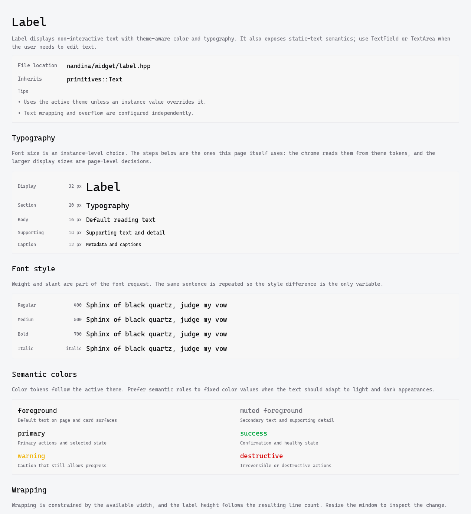
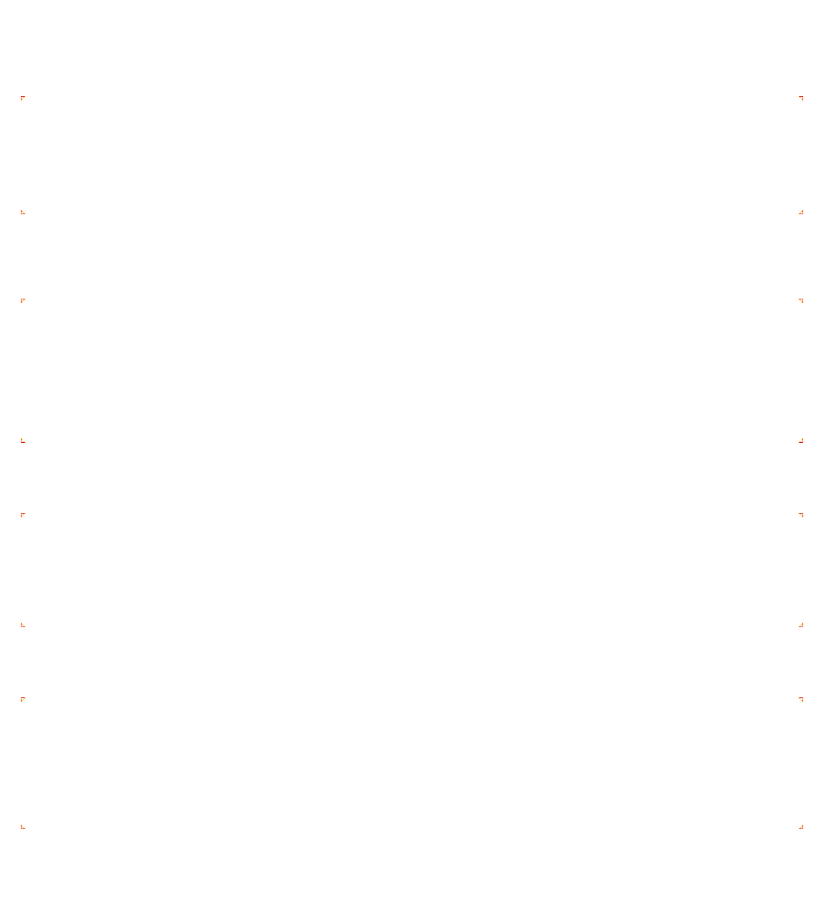
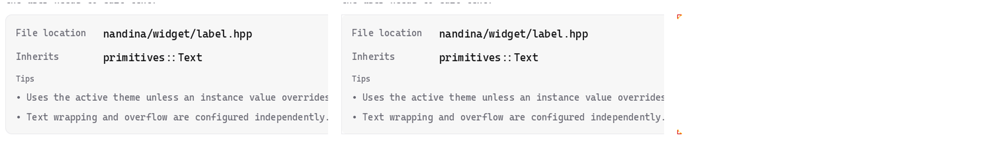
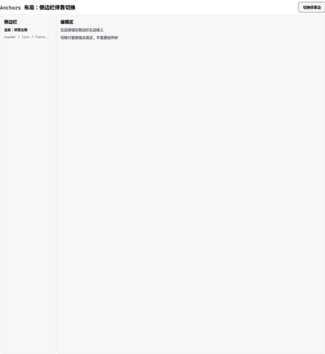
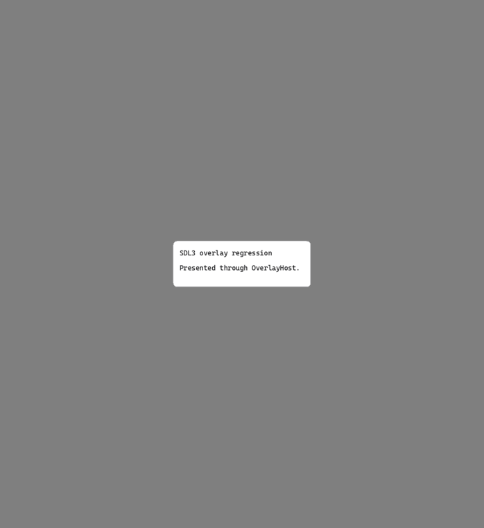
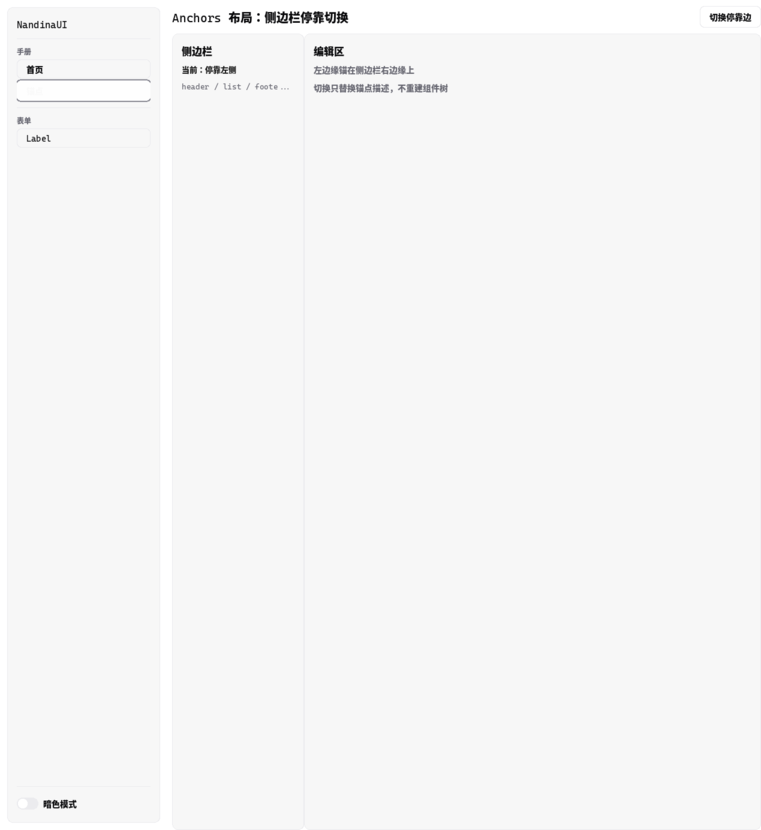

# 跨平台后端探测：SDL3 GPU 与 Web 现状

> 本文是 D4「跨平台优先的窗口与渲染后端路线」的**探测证据记录**：按
> [开发流程](development_loop.md) 的语言区分「已证明」「未验证」和「只是路径选择」。
>
> **方向已定**（作者 2026-10-15）：先补齐 D4 计划内容，随后把生产后端替换为 SDL3。
> 目标形态、所有权划分、能力契约与阶段验收见[平台与后端契约](platform_backend_contract.md)；
> 本文只负责「测到了什么、没测什么」。迁移本身尚未开始，raylib 仍是唯一生产路径。

**探测源码已入库**：[probe/cross_platform/](../../probe/cross_platform/README.md)（`desktop/`、`web/`、
`tools/verify_toolchain.sh`）。只追踪源码：SDL 源码树、emsdk、构建产物仍然现取现建
（构建目录约定放在已忽略的 `playground/probe-build/` 下）。工具链的**唯一核对入口**是

```sh
probe/cross_platform/tools/verify_toolchain.sh   # 打印并校验所有固定版本，缺必需项则退出 1
```

## 1. 桌面侧：SDL3 GPU-backed Renderer（Linux / Vulkan）

**已证明的一件事**：SDL 3.4.18 的 GPU-backed Renderer 能在本机加载由 HLSL 编译出的 SPIR-V
fragment shader，并把它应用到一个被 `SDL_SetRenderClipRect` 裁剪的 `SDL_RenderTexture` 上；
圆角 SDF、软阴影和裁剪在运行截图中可见。构建把 shader 纳入依赖图，产物同时进入构建树与安装目录
（`bin/assets/sdf.frag.spv`），安装版也能启动。

固定与工具链：

| 项 | 值 |
| --- | --- |
| SDL | 系统 `sdl3>=3.4.0`，实测 3.4.18 |
| shader 编译器 | `glslc`，**配置期硬校验 2026.4** |
| 编译命令 | `glslc -x hlsl -fshader-stage=frag --target-env=vulkan1.0` |
| SPIR-V 校验器 | `spirv-val`（SPIRV-Tools），**配置期硬校验 v2026.4，且已接进构建图** |
| 运行时定位 | `SDL_GetBasePath()/assets/sdf.frag.spv`，空或非 4 字节对齐时拒绝 |
| 产物 | 构建树 `build/assets/` + 安装树 `bin/assets/`（不嵌入可执行文件） |

从入库后的受追踪位置重新构建并运行过一次（2026-10-15）：`SDL 3.4.18, renderer=gpu,
shader-formats=0x2, DPI=1`，窗口正常出帧。校验门也实测有效 —— 把 `generated/sdf.frag.spv`
替换成垃圾数据后构建在 `spirv-val` 一步失败（`error: file size should be a multiple of 4`），
而不是留到运行时。

**未验证**（不要把它读成更大范围的支持）：

- atlas 是**合成纹理**（手写像素的 64×64 块状字形），不是 Nandina 的 `GlyphAtlasTexture`
  接 `IRenderDevice`。字体图集上传路径、脏矩形上传与扩容重建都没有经过。
- SDL 键码映射只覆盖 Space / 方向键，且**没有经过实际按键验证**；Nandina 侧的规范键值
  （`widget/key_codes.hpp` 目前直接是 GLFW 码）也未接入。
- 窗口尺寸来自合成器平铺变化，不代表 DPI 或多屏验收；截图里的尺寸与请求值不同。
- 探测里仍然没有**测试目标与图像断言**。`spirv-val` 已经不在此列：它现在在构建图里，
  版本被硬校验，失败会中断构建（上一节有实测）——但「渲染出来的像素对不对」仍然只靠人看截图。
- 只覆盖了现有 SDF 图元的**一个子集**（一个 fragment shader、一种裁剪），没有对齐
  `IRenderDevice` 的 `draw_arc` / `draw_circle_clipped_rounded_rect` / 描边吸附等行为。

**探测方法本身有一个已知偏差**：探测程序不经过 Nandina 的 `IRenderDevice`，也不挂载页面。
在 [布局收敛](layout_convergence_and_text_measurement.md) 修复之前，真实页面 80 ms/帧里有 71 ms 是
CPU 布局，因此**不能**用这个探测对后端做性能结论。后续如果要比较后端，应当跑
`playground/bench/label_bench.cpp` 那种真实页面负载，而不是 SDK 示例。

## 2. Web 侧：两条不同的路径

| 路径 | 能力 | 本项目要验证的内容 |
| --- | --- | --- |
| SDL GPU-backed Renderer（桌面） | SDL 3.4+ `SDL_GPURenderState` 提供自定义 fragment shader | 见 §1；Vulkan 已试，D3D12/Metal 未试 |
| SDL 2D Renderer 的 Emscripten/WebGL 路径 | 只有 SDL 2D 绘制 API + 自定义几何；**不能**沿用桌面的自定义 fragment shader | SDF 是否退化为 CPU 细分几何/覆盖率；是否需要独立 Web device |
| 桌面 GPU renderer + Web 专用 renderer | 各平台保留各自最强的光栅化方式 | 多 `IRenderDevice` 实现的视觉回归、行为一致性与长期维护成本 |

### 2.1 已有两次 Web 构建，但都没有完成浏览器验收

- [probe/cross_platform/web/](../../probe/cross_platform/web/CMakeLists.txt)：用 `SDL_CreateRenderer(window, nullptr)` 的默认 WebGL2 路径，
  `SDL_MAIN_USE_CALLBACKS` 主回调模型，链接参数 `-sMIN/MAX_WEBGL_VERSION=2`、
  `-sALLOW_MEMORY_GROWTH=1`、`-sEXIT_RUNTIME=0`。用本地 emsdk（Emscripten 6.0.10）成功产出
  `html/js/wasm`。内容为 CPU 生成的圆角矩形三角网格 + 16×16 位图 atlas + `SDL_RenderDebugTextFormat`。
  上一次的截图停在 Emscripten 加载壳的 "Downloading…" 上、画面是黑的，**无法据此判定成功或
  失败**。**2026-10-15 已完成有效验收**，见 §2.1.1。
- 另有一个独立的 SDL3 2D Renderer Web 示例（`/workspace/Cpp/playground/hello_emsdk`，不在本仓库内）：
  `SDL_CreateWindowAndRenderer` + `SDL_MAIN_USE_CALLBACKS`，随源码 vendored SDL **3.5.0**，
  用 `emcmake cmake -S . -B dist/web` 配置、`cmake --build` 构建，产物拷到 `public/js/` 由静态服务器打开。
  这条路径在本机浏览器里**实际跑起来了**（画面、输入、resize 都正常），是当前唯一被人工确认过的
  Web 运行记录。它证明的是「SDL 2D Renderer 路径可用」，不是「Nandina 在 Web 上可用」。

  注意示例自身的脚本不一致：`config-wasm.sh` 配置到 `dist/web`，而 `build-wasm.sh` 构建的是 `dist/`
  （`dist/` 里是更早一次配置留下的产物）。复用这套脚本前需要先统一构建目录。

#### 2.1.1 有效的浏览器验收：让探测自己上报（2026-10-15）

截图这条路在这个环境里走不通：`firefox --headless --screenshot` 在 2 MB wasm 实例化**之前**
就截图（两次复现：画面全黑 + 加载壳）。所以探测改成**自证**：跑满若干帧后自己读回帧缓冲
（`SDL_RenderReadPixels`），统计像素，再 `fetch('/probe-report?...')` 回服务器 ——
用 `python3 -m http.server` 的请求日志当证据，不依赖截图时机。

```sh
source playground/sdl_gpu_probe/emsdk/emsdk_env.sh
emcmake cmake -S probe/cross_platform/web -B playground/probe-build/web -G Ninja \
  -DNANDINA_SDL_SOURCE_DIR="$PWD/playground/sdl_gpu_probe/SDL"
cmake --build playground/probe-build/web
python3 -m http.server 8901 --bind 127.0.0.1 --directory playground/probe-build/web &
timeout 60 firefox --headless --no-remote --profile /tmp/ff-profile \
  http://127.0.0.1:8901/nandina_sdl_web_probe.html
grep -o 'GET /probe-report?[^ ]*' /tmp/webserver.log
```

实测输出（640×480 canvas = 307200 像素，Emscripten 6.0.10，headless Firefox，软件 WebGL）：

```
stage=renderer-created  detail=opengles2
stage=rendered  frames=2   ink=9556  teal=6220  total=307200
stage=rendered  frames=32  ink=9556  teal=6220  total=307200
stage=rendered  frames=92  ink=9556  teal=6220  total=307200
```

**已证明**：SDL 的 2D renderer 路径在真实浏览器里拿到 WebGL2 上下文（`opengles2`）、持续出帧
（跑满 92 帧以上），并且**画布上确实有预期的像素** —— 9556 个非背景像素里有 6220 个是圆角矩形
的主色。失败路径也上报（`stage=init-failed` / `renderer-failed` 带 SDL 错误串），所以
「黑屏」不再分不清「没加载完」「没有 WebGL2」「渲染报错」。

**未证明**：Nandina 本身在 Web 上能跑（这个探测是独立程序 + CPU 几何，不是 `IRenderDevice`）、
性能、输入与事件、以及 WebGL1（不承诺）。

### 2.2 暂定路线（仍未定案）

保留共享的 `IRenderDevice` 契约，Web 使用**单独的**实现接 SDL 2D Renderer / WebGL，
并接受 Web 端 SDF 光栅化与桌面存在可见差异。前置条件：

1. ~~需要一次**有效的浏览器运行验证**~~ —— 已完成，见 §2.1.1（画布像素读回 + 服务端记录）。
2. WebGL2 是最低要求（当前 shader 依赖 `fwidth` 导数）；WebGL1 不在承诺范围内。
3. 能力差异要写成**代码里的能力查询**（`IRenderDevice` 已有 `supports_alpha_textures` /
   `supports_rounded_rect` 的先例），而不是只写在文档里 —— 否则 SDK 示例跑通会被误读成
   「Nandina 应用已支持」。

## 2.3 真实 IRenderDevice 路径（新增，2026-10-15）

探测记录 §4 把「让探测走一次真实的 `IRenderDevice` 实现」列为 P1 的前置条件。现在有了：
[probe/cross_platform/desktop/sdl_render_device.hpp](../../probe/cross_platform/desktop/sdl_render_device.hpp)
用 SDL 的 2D API 实现了该契约，圆角与圆走 **CPU 三角形扇**（`SDL_RenderGeometry`），
不依赖自定义 shader —— 这同时验证了 §2.2 给 Web 定的暂定路线（CPU 几何/覆盖率 + 独立设备）。

一次 30 帧运行的统计与证据：[sdl-render-device.png](../images/probe/sdl-render-device.png)

```
device stats: frames=30 rects=420 outlines=30 rounded=90 circles=90 lines=600 texts=30
              textures=30 alpha_uploads=2 clips=60 cpu_vertices=9750
device capabilities: alpha_textures=1 rounded_rect=1
```

**已验证**：填充/描边、圆角矩形、圆、线段、由接口默认实现派生的 `draw_arc` 与
`draw_circle_clipped_rounded_rect`、`draw_text`、alpha 图集创建 + 按子矩形更新、纹理区域绘制
与 tint、`set_clip` 裁剪、两个 capability 查询。

### 2.3.1 真实页面已经跑通（同一天，第二个目标）

手写图元只证明「契约可实现」。真正回答 §4 第 2 件事的是
[probe/cross_platform/desktop/page_probe.cpp](../../probe/cross_platform/desktop/page_probe.cpp)：
它用 `NanApplication` + `NanRouter` + `NanSceneTree` 组成一个**最小宿主**（不用 `NanWindow`），
挂载**真实的 showcase `LabelPage`**，走真实主题、HarfBuzz 整形与 `GlyphAtlasTexture`，
再用 `NanSceneTree::draw(device)` 整棵树画到 SDL 设备上。构建：`-Dsdl_page_probe=true`。



版式、字体（regular/medium/bold/italic）、主题色、圆角卡片与裁剪都与 raylib 基线一致。
同一页面的稳态成本（无 vsync，91832 帧平均）：

```
frame cost: layout=0.005 ms, draw=1.85 ms, total=1.85 ms   （每帧约 1277 次纹理绘制）
```

两条可与基线对照的结论：**稳态 0 次布局**（与 raylib 上测到的收敛性质一致），以及 draw 成本
与 raylib 基准（约 2.2 ms）同量级 —— 但**不能按质量对比**，本设备圆角无抗锯齿。
每帧 1277 次纹理绘制说明文本路径是逐字形提交的，批处理是后续的优化项（两个后端同样如此）。

**踩到的一个真实 bug**：`SDL_PIXELFORMAT_RGBA8888` 是打包格式（`0xRRGGBBAA`），小端机上内存
字节序为 `A,B,G,R`，与设备产出的 `R,G,B,A` 缓冲不一致 —— alpha 从错误字节读出，每个字形都画成
不透明方块。改用 `SDL_PIXELFORMAT_RGBA32`（平台首选）修复；并补上 `SDL_SCALEMODE_NEAREST`
以对齐生产后端的字形图集点采样。

### 2.3.2 同页跨后端像素对照（2026-10-15）

把**同一个页面**（showcase `LabelPage`，未滚动；两边窗口都是 1269×1383 的合成器平铺尺寸；
都用内建默认主题）分别交给两个后端，再逐像素比对：

| | 采集方式 |
| --- | --- |
| raylib | `NANDINA_BENCH_SCREENSHOT=... ./buildDir/playground/label_bench label`（raylib `TakeScreenshot`） |
| SDL 2D | `NANDINA_PROBE_CAPTURE=... ./buildDir-nandina-sdl-probe/probe/cross_platform/desktop/nandina_sdl_page_probe`（帧缓冲读回） |

结果（1269×1383 = 1.75 M 像素）：

```
mean |Δ| = 0.0033      >8: 338 px (0.019%)      >16: 176 px (0.010%)      max = 20/255
```

差异全部落在**边缘抗锯齿**：最大差异点在卡片左边框（raylib 画成纯白、SDL 画成 235,235,238），
176 个像素里 18% 是孤立点、其余是边缘小簇。即在该页面上，几何路径（无抗锯齿）与 SDF 路径
（`fwidth`）的差别上限是 20/255，只影响万分之一的像素。



左 raylib / 中 SDL / 右差异（橙 >8、红 >16）：



**这次对照本身有一个教训**：第一版 `mean |Δ| = 4.51`、44.6% 的像素不同，但最大差异也只有 20 ——
看起来像"到处都是细微色差"，实际是**宿主清屏色不同**：raylib 窗口清成白色，我的最小宿主清成了
主题背景灰（245,246,248）。页面自己只画卡片与文本，**最外层背景由宿主决定**，所以那是宿主选择
而非后端差异；把探测清屏色改成白色后 mean 从 4.51 掉到 0.0033。这条直接进 P4：应用背景由谁
绘制必须写进 host 契约。

**没有被这次对照覆盖的差异**（同一页面不触发）：软阴影（默认主题的卡片没配阴影）、圆角裁剪与
水波纹（没有点击）、`draw_arc`、图像文件加载。它们由 §2.3 的能力查询 + 单元测试负责 —— 不能
因为「像素对照通过」就认为已经覆盖。

**一条 P4 限制**：`NanWindow` 自己构造并持有设备，raylib 后端的**调用序列无法被包装或插桩**，
所以这次对照只能是像素级，做不了逐图元对照。要拿 raylib 的逐图元 trace，先得有设备注入 ——
这正是 P4 要解决的事。

#### 2.3.3 消费者回归：三个 showcase 页面全过一遍（2026-10-15）

只对照一个页面不够 —— 把三个页面都交给 SDL 设备，逐个与 raylib 基线比对，**扫出一个只有
anchors 页面才暴露的真实缺陷**：

| 页面 | 修复前 | 修复后 | 稳态成本（SDL） |
| --- | --- | --- | --- |
| Home | **逐像素相同**（max 0） | 相同 | layout 0.001 ms / draw 0.45 ms |
| Label | mean 0.0033、max 20 | mean 0.0009、**max 9** | layout 0.005 ms / draw 1.93 ms |
| Anchors | mean 0.0135、**max 116**、124 px >24 | mean 0.0068、**max 55**、42 px >24 | layout 0.002 ms / draw 0.14 ms |

**扫出的缺陷**：anchors 页右上角按钮的圆角**描边**在 SDL 上画成了方框（max 116 就集中在那四个
角）。根因不在 painter，而在设备：`IRenderDevice::draw_rounded_rect_outline()` 的**接口默认实现
会退化成方框描边**（注释写的是"测试设备可不实现"），而 `SdlRenderDevice` 当时只实现了圆角填充。
raylib 后端是覆写了这一条的（`raylib_device.cpp:264`），所以只有新设备会踩到。

```cpp
// probe/cross_platform/desktop/sdl_render_device.cpp（修复）
// 圆角描边 = 四条直边矩形 + 四个同心环扇（外半径 r、内半径 r-t，圆心相同）。
```


修复后剩余的差异全部是**角上的抗锯齿**（几何路径无 AA），与 Label 页的结论一致。三个页面的
**稳态布局都是 0 次**（0.001–0.005 ms）—— 收敛性质在三个页面 × 两个后端上都成立。

anchors 页面在 SDL 后端的完整渲染（`rounded_outlines=160/80 帧`，即新的描边路径确实被走到）：



**这条经验值得单独记**：接口里"默认实现会静默降级"的入口（`draw_rounded_rect_outline` →
方框、`draw_circle_clipped_rounded_rect` → 未裁剪、`draw_rounded_rect_shadow` → no-op）是新后端的
三个坑。前两个已经在本设备实现或被能力查询覆盖，软阴影由 `supports_soft_shadows()` 降级。

#### 2.3.5 浮层回归与「宿主阶段」契约（2026-10-15）

`NANDINA_PROBE_OVERLAY=1` 用 `BuildContext` 构建一个真实 `Dialog`（走 `ComponentTraits<Dialog>`
注入 overlay service）、挂到 RouterOutlet 下并 `open()`，然后核对
`OverlayHost::overlay_count()` 与截图：

```
overlay report: open=1 overlay_count=1
```



**走过的坑（三条宿主契约，全部进 P4）**：

1. 手搓 `Dialog::create()` 拿不到 overlay service，`open()` 会**静默退化成树内 z 序**，
   `overlay_count` 保持 0；必须经 `BuildContext` 构建。
2. no-shell 模式把树根挂在 `RouterOutlet` 上，而 `OverlayHost` 不在树里 —— 浮层会 present 到
   一个**没人绘制的宿主**上（`count=1` 但画面里什么都没有）。真实宿主（`NanWindow`）是以
   OverlayHost 为根的。
3. 宿主必须跑完整阶段链，**只调 `process()` 不够**：浮层淡入在 `advance_animations()` 里推进，
   漏了它就会出现「对话框已打开但不可见（面板 opacity 停在 0）」，以及「hover 过渡不动」。
   探测现在照抄 `NanWindow::tick` 的顺序：`process → flush_tree_mutations/deferred_deletes →
   physics_step → advance_animations`，再 layout / semantics / draw。

#### 2.3.4 外壳与交互态回归（2026-10-15）

静态页面全过一遍之后，剩下的是**外壳**与**交互态**：探测现在可以用
`NANDINA_PROBE_SHELL=1` 挂载**真实的 showcase 外壳**（`ShellContext` + `Sidebar` + `RouterOutlet`
在同一棵树里），并用 `NANDINA_PROBE_INTERACTION=1` 注入确定性输入：在导航按钮的
`global_bounds()` 中心依次派发 `MouseMove` → `MouseButton(press)` → `MouseButton(release)`，
然后读**框架自己的状态**核对（`Pressable::hovered()/pressed()`、`Button::treatment()`、
`Router::current_page_key()`），不看截图猜。

三个起始页面（home / anchors / label）结果一致：

```
interaction report: hovered=1 pressed=1 route_switched=1 selected_treatment=1
frame cost: layout=0.04 ms, draw=0.27 ms（含侧边栏）
```



上图就是「注入点击之后」的状态：侧边栏「锚点」条目变成选中态（filled），内容区切到 Anchors 页。

**这一步顺带挖出两条 host 契约**（都进 P4，且都是"漏了就表现为诡异 bug"的类型）：

1. **Router 换页是投递给 `UiDispatcher` 的**，宿主必须在每帧的 tasks 阶段取出来 ——
   `NanWindow` 在 `FramePhase::tasks` 里调 `dispatcher().drain()`（`nan_window.cpp:462`）。
   最小宿主漏掉这一步时，点击回调正常执行、**路由却不换**，现象就是「按了没反应」。
2. **动画只在宿主推进时间时前进**：宿主必须调 `NanSceneTree::process(dt)`（`NanWindow` 的
   process 阶段）。而且探测里必须用**固定步长**（1/60）而不是墙钟差 —— 这个探测不锁帧
   （几千 fps），墙钟 dt 会让过渡动画在模拟时间里几乎不动，交互回归永远看不到终态。

**后续修正（同一天）：那条"hover 圆角不动"的观察是探测自己的 bug，不是框架问题。** 探测只调了
`tree.process(dt)`，没调 `tree.advance_animations(dt)` —— 动画阶段根本没跑。补上完整宿主阶段后，
侧边栏的 hover 增益正常过渡并停在终值：

```
[anim] frame=3  radius=8        state=1（hovered）
[anim] frame=6  radius=8.69444
[anim] frame=9  radius=9.88889
[anim] frame=12 radius=10       ← 基值 8 + hover 增益 2，之后保持
```

这条教训比原来的"观察"更值钱：**宿主少跑一个阶段，症状会伪装成框架缺陷**（见下面第 3 条契约）。

**未验证**的部分见下表。

**能力差异**（记录在案，不是等价实现）：

| 项 | 生产 raylib 后端 | SDL 2D 设备 | 影响 |
| --- | --- | --- | --- |
| 圆角/圆抗锯齿 | SDF + `fwidth` | 无（硬边缘，分段 6–48） | 视觉差异；Web 路线要接受或用覆盖率 |
| `draw_circle_clipped_rounded_rect` | SDF 解析交集 | 矩形裁剪 + 圆（圆角处方角） | 图标/头像的裁剪会露方角 |
| `draw_arc` | SDF 环 | 接口默认（弦逼近，≤64 段） | 可见折线 |
| `draw_rounded_rect_shadow` | SDF 软阴影 | no-op | 弹层/卡片阴影缺失 |
| 文本 | HarfBuzz + `GlyphAtlasTexture` | `SDL_RenderDebugText` 内置字体 | 只证明文字落在同一套坐标/裁剪里 |
| alpha 图集 | A8，raylib 扩成 RGBA8 | A8 → RGBA8（同样 4×），按行段上传子矩形 | 与生产后端同构的内存代价 |
| 图像文件加载 | 有 | no-op | 需要解码器或 SDL_image |

**构建层的事实（P4 的输入）**：`IRenderDevice` 头文件是 header-only，但它用到的 foundation
值类型有 out-of-line 实现，所以独立设备要么链 `libnandina`、要么编进三个 foundation TU
（探测选了后者）。「设备实现可插拔」在构建层面并不成立，这条要进入 P4 的 host 行为契约。

## 3. Shader 构建链（P1 门槛）

现状：Nandina 的 SDF shader 是**内嵌在 `render/backends/raylib_device.cpp` 里的 GLSL 330 字符串**，
一个 `uMode` 管 6 种图元（fill / outline / segment / clipped_circle / shadow / arc）。
探测里换成了一份 HLSL 源 + glslc 预编译 SPIR-V。P1 需要把下面几条定下来：

- **canonical shader source 与转换链**：选 HLSL 还是 glslc 可编译的 GLSL 子集；
  若要覆盖 D3D12/Metal，需要 SPIR-V/DXIL/MSL 各自的产物与来源前端。
- **host tool 是构建机依赖**：固定版本、固定获取方式，跨编译时执行 host 版本；
  不依赖开发机上"刚好装好"的工具。
- **产物进构建图与最终包**：源 shader 变化必须触发重新生成；安装/打包带上所需二进制；
  运行时不得偷偷要求构建机工具。
- **失败可定位**：报源文件、目标 backend/format、工具版本与诊断输出；CI 对每个承诺的格式
  实际生成并加载。

### 3.1 `SDL_shadercross` 已构建验证（2026-10-16）

候选提交 `1ff05bec573988a98ef9e0260b4da44f512b8367`（= 当时 main）已在本机构建成功，
并且**每个承诺格式都实际生成了产物** —— 一条命令可复现：`tools/verify_shadercross.sh`。

```
OK    HLSL -> SPIR-V             2204 B, magic 03022307
OK    spirv-val (external)       shadercross 的 SPIR-V 产物通过独立校验
OK    SPIR-V -> DXIL             4552 B, DXBC container
OK    SPIR-V -> MSL              1607 B, metal_stdlib 入口
OK    SPIR-V -> HLSL             1805 B, 资源绑定可见
```

值得单独说的是 **`spirv-val` 那次校验**：产物不是"我们自己看了一眼觉得对"，而是被
**工具链里那份独立的 `spirv-val`**（与 shadercross 自带的 SPIRV-Tools 是两份）接受。
这是本机能拿到的最强证据。

构建本身踩了三个坑，都写进了脚本的 `BUILD_HINT`：DXC 的**嵌套子模块**
`external/DirectX-Headers`（少了它缺 `d3d12shader.h`）、vendored SPIRV-Tools 在 GCC 14 上的
`-Werror=array-bounds` 误报、以及 `SDLSHADERCROSS_SPIRVCROSS_SHARED=ON` 默认要求**预装**
的 spirv_cross（要么装，要么 `VENDORED=ON` + 静态）。

**仍然未验证的是"加载"**：DXIL 需要 D3D12 设备、MSL 需要 Metal 设备，而这台验收机是
Linux/AMD。脚本把两条命令打印出来（`xcrun metal`、`dxc -dumpbin -verify`），
在对应平台上补跑即可 —— 这是外部阻塞，不是"没做"。

`SDL_GPURenderState` 的 API floor 是 SDL 3.4.0：对外声明的最低版本不得低于它，
CI/SDK 再固定精确受测版本并在升级时复检。P1 的交付物是「目标 driver 上可用 + 已知限制清单」，
不等同生产就绪。

## 4. 与 D4 交付顺序的对应

| D4 阶段 | 当前状态 |
| --- | --- |
| P0 SDL3 应用级探测 | **基本完成**：窗口/事件/帧循环、GPU render state 的自定义 SDF shader、真实的 `IRenderDevice`（SDL 2D + CPU 几何），以及**真实 showcase 页面 + 真实字体图集**（§2.3.1）都已跑通；仍缺键码映射验证 |
| P1 渲染与 shader 管线门槛 | **基本完成**：工具链固定并可一条命令核对（`glslc`/`spirv-val`/SDL/emsdk）、SPIR-V 校验进构建图、能力降级路径（阴影/圆角裁剪）、同页像素对照（§2.3.2）、Web 端有效验收（§2.1.1）、**`SDL_shadercross` 的 SPIR-V/DXIL/MSL 产物已实际生成并被独立 `spirv-val` 接受**（§3.1，`tools/verify_shadercross.sh`）；仍缺 DXIL/MSL 的**加载**（需 D3D12/Metal 设备）与逐图元等价性（trace 设备尚未写） |
| P2 平台能力与消费者回归 | 未开始 |
| P3 默认后端决策 | 未开始；`raylib` 仍是唯一生产路径 |
| P4 host 行为契约 | 未开始；`NanWindow` 仍同时持有窗口、设备、输入轮询与帧驱动 |

在 P1 之前建议的两件事，第 1 件已完成（§2.3）；第 2 件仍未做：

1. ~~让探测走一次**真实的 `IRenderDevice` 实现**~~ —— 已完成，见 §2.3。
2. ~~用真实页面负载而不是 SDK 示例做性能与视觉对比~~ —— 已完成（§2.3.1：真实 `LabelPage`
   经 `NanSceneTree::draw(device)` 渲染，稳态 0 次布局、draw 1.85 ms/帧）。
   下一步是把两个后端的**同一页面**做逐像素/逐图元对照，并把圆角抗锯齿、软阴影、
   圆角裁剪这些能力差异变成设备能力查询驱动的降级路径。

## 5. 相关记录

- 探测源码与构建说明：[probe/cross_platform/README.md](../../probe/cross_platform/README.md)
- 工具链核对：`probe/cross_platform/tools/verify_toolchain.sh`
- 探测证据截图：[docs/images/probe/](../images/probe/)（`sdl-gpu-vulkan.png`、`sdl-gpu-vulkan-top.png`）
- 视觉基线：[raylib 基线（2026-10-13）](../images/baselines/raylib-2026-10-13/README.md)
- 布局收敛（为什么不能拿旧数据做后端性能结论）：[布局收敛与文本测量](layout_convergence_and_text_measurement.md)
- D4 的待审阅问题与 host 行为契约：[待决设计草案](reference_draft.md#d4-跨平台优先的窗口与渲染后端路线)
