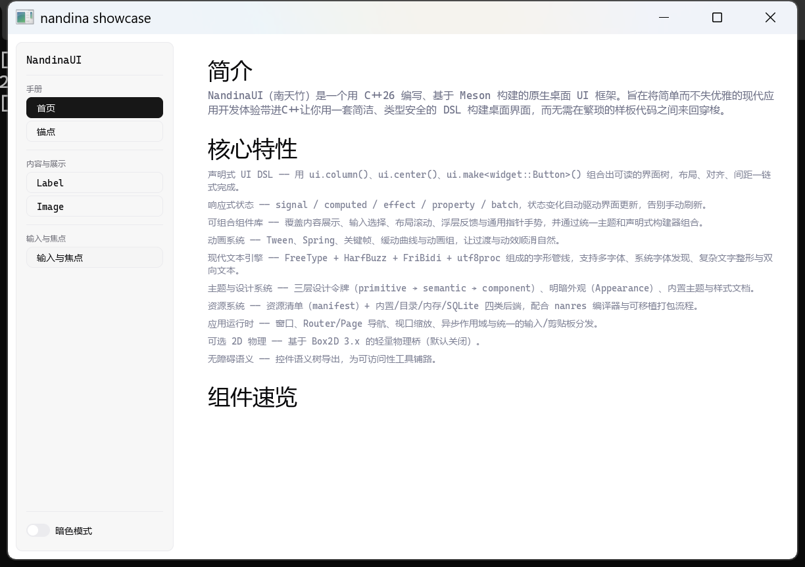
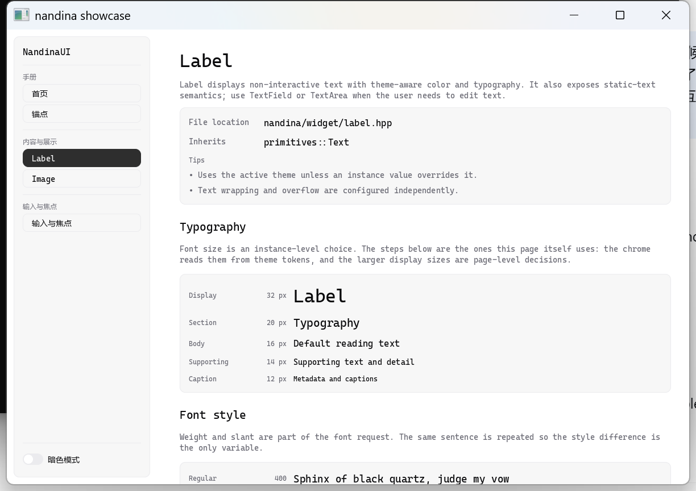
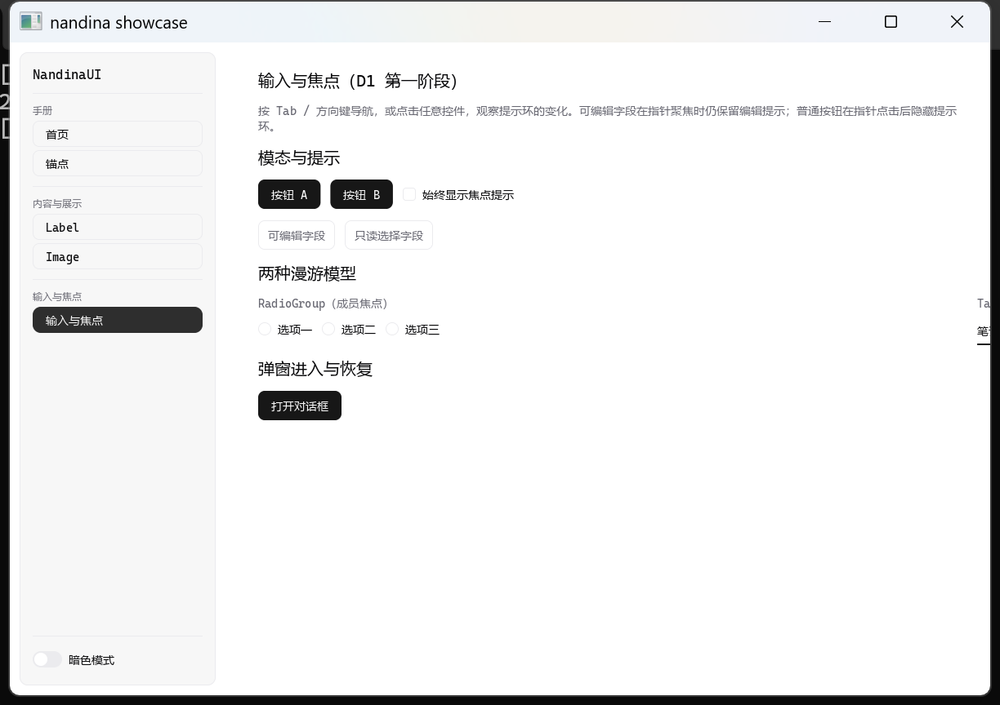

# 高 DPI 与多显示器：已知缺陷与待定契约

> **状态（2026-11-09）**：维护者报告“高 DPI 电脑上应用表现效果不佳”，并指出这会牵出多显示器
> 不同 DPI、内部组件缩放、文字渲染与组件交互等新问题。本文记录已复现的现象、当前实现事实、
> 根因候选与**实施前必须先定形的问题**。按维护者安排，实现排在本轮 Windows 验收之后；本文
> 不是已接受契约，后续定稿可能与这里不同。
>
> 本轮 Windows 验收（默认 swapchain 合成读回、工具链修复）**不包含** DPI 实现。

## 1. 报告与复现（2026-11-09）

维护者报告：高 DPI 显示器上应用观感不佳。

本机复现（Windows 11 26200，AMD Ryzen 5 6600H + Radeon 660M，面板 2880×1800，
`HKCU\Control Panel\Desktop\WindowMetrics\AppliedDPI = 168`，即 **175%** 系统缩放）：

| 观测 | 值 |
| --- | --- |
| showcase `WindowConfig{width=1200, height=800}` | 日志 `SdlPlatformWindow: ready 1200x800 renderer=gpu` |
| `GetDpiForWindow`（DPI-aware 进程） | 168（1.75×） |
| DPI-aware `GetWindowRect` | 外框 1224×864；客户区 **1200×800 物理像素** |
| 按内容缩放模型的期望 | 客户区约 2100×1400 物理像素，文字按 1.75× 密度栅格 |

整窗截图（1224×864 物理像素，桌面会话）：

| 页面 | 截图 |
| --- | --- |
| home |  |
| label |  |
| 输入与焦点 |  |

可见布局、字号与命中目标都按 **1× 物理像素**绘制：在 175% 面板上窗口与文字明显偏小。
渲染本身不糊（framebuffer 与窗口 1:1，文字按 1× 栅格化），问题是**没有应用 OS 内容缩放**，
因此既没有“放大到设计尺寸”，也没有获得高密度文字应有的清晰度收益。

## 2. 当前实现事实（源码核对）

- `WindowConfig::high_dpi = true` 只映射为 `SDL_WINDOW_HIGH_PIXEL_DENSITY`
  （`nandina/app/detail/sdl_platform_window.cpp`）。
- `SdlPlatformWindow::screen_size()` 取 `SDL_GetWindowSize`，`drawable_size()` 取
  `SDL_GetWindowSizeInPixels`。Windows 的 per-monitor DPI aware 进程中两者都是物理像素，
  于是 `make_window_metrics(...)` 得到 `framebuffer_scale = 1`、`screen_to_physical = 1`。
- SDL3 的 `SDL_GetWindowPixelDensity()` 在 Windows 上恒为 1（它表示“framebuffer 像素 /
  window 坐标”，Windows 没有独立 DIP 坐标）；真正的 OS 缩放来自
  `SDL_GetDisplayContentScale()` / `SDL_GetWindowDisplayScale()`，框架当前**没有调用点**
  （只有探针与 SDL 子项目内部使用）。
- 框架未监听 `SDL_EVENT_WINDOW_DISPLAY_SCALE_CHANGED` /
  `SDL_EVENT_WINDOW_PIXEL_SIZE_CHANGED` 这类显示缩放变化，跨屏移动不会触发重新缩放或重栅格。
- `WindowMetrics` 已预留 `screen_to_physical` 与 `framebuffer_scale_is_uniform`，
  `GlyphRunRenderer` 会按 `logical_to_screen * screen_to_physical` 栅格化字形；但该值在
  Windows 上恒为 1，预留结构没有接到 OS 缩放。
- `ViewportScalePolicy` 的注释已写明：DPI scale 与 accessibility scale 属于**后续独立乘数**，
  不能写进固定设计视口（`nandina/app/viewport_scaling.hpp`）。
- 输入/焦点侧：`docs/references/focus_and_input.md` §5.4 明确 `NanWindow` 传窗口逻辑尺寸且
  “不乘 drawable/DPI 比例”。一旦引入内容缩放，caret/text input area 与 IME 候选窗坐标的
  既有契约需要重核。

## 3. 实施前必须定形的问题

1. **单位与坐标模型**：作者和组件使用 logical/DIP 还是物理像素？`WindowConfig::width/height`
   的语义是窗口逻辑尺寸还是 framebuffer 像素？内容缩放乘数（OS DPI × 可选 accessibility
   scale）在哪一层引入、由谁持有？
2. **与固定设计视口（`ViewportScalePolicy`）的关系**：设计尺寸→屏幕的 uniform mapping 已经
   存在；DPI scale 是独立乘数还是并入同一 mapping？组合后的 draw / hit-test / text input
   area 转换顺序必须定形，不能让两套缩放互相污染。
3. **组件缩放模型**：整体缩放（布局保持 logical，渲染出口统一放大）还是逐组件密度感知？
   前者改动集中，但描边/阴影/裁剪/图片/字形纹理都要在出口正确；后者需要每个组件声明尺寸
   策略，并与 `layout_size_epsilon`、像素对齐与缓存键交互。
4. **文字渲染**：字号声明单位；非整数缩放（本机 1.75×）下的栅格化取整、hinting 与
   亚像素定位；字形图集缓存键必须携带有效 pixel size；行高/基线与布局取整要一致。
5. **多显示器混合 DPI**：窗口在 100% ↔ 175% 显示器之间移动时的重布局/重栅格/重建 framebuffer
   时机；`DISPLAY_SCALE_CHANGED` 与 `PIXEL_SIZE_CHANGED` 的先后与去抖；移动中动画/输入是否
   中断；tooltip、cursor 与 popup 的定位。
6. **交互与无障碍**：鼠标/触摸坐标（物理）到逻辑的换算；滚动、拖拽阈值、焦点环与命中区域；
   文本输入区与 IME 候选窗在 Windows 上应交给物理还是逻辑坐标；语义树 bounds 的单位。
7. **测试与基线**：页面 golden 与设备级像素测试当前隐含 1×；`page_probe` 使用
   `SDL_WINDOW_HIGH_PIXEL_DENSITY` 隐藏窗口，在 Windows 上仍是 1×。需决定 probe 固定 DPR
   还是在 manifest 增加 scale 维度；跨 DPI 不得直接比较基线。
8. **平台差异**：Windows/macOS 的 pixel density 语义不同；Linux Wayland 分数缩放
   （1.25/1.5）与 X11 的行为不同；先核对 SDL3 在各平台的查询/事件能力，再承诺支持面。

## 4. 验收建议（实施批次）

- **单元**：`WindowMetrics` 与坐标映射在 1.0/1.25/1.5/1.75/2.0 下的解析断言；输入→逻辑、
  逻辑→物理与 text input area 往返；缓存键包含缩放。
- **真实窗口**：Windows 175%（本机可复现）与 100%/175% 双屏双向移动；Linux Wayland 分数
  缩放与 X11 分别记录。期望：窗口按逻辑尺寸 × scale 打开、文字按物理密度栅格且清晰、
  按钮/滚动/文本光标命中无偏移、跨屏移动无错位/闪烁/崩溃。
- **回归**：现有页面 golden 与 `sdl-visual`/`sdf-device` 在固定 1× probe 下保持通过；
  DPI 场景单独记录，不与 1× 基线混比。
- **文档**：更新本文、`linux_window_scaling.md`、`focus_and_input.md`（caret/IME 坐标）、
  `visual_regression.md`（scale 维度）与 `windows_acceptance.md` 的人工验收项。

## 5. 非目标与明确延后

- 本轮 Windows 验收不包含 DPI 实现；不得把本文当作“已支持高 DPI”的依据。
- accessibility 文本缩放/系统字体缩放、HDR、每显示器色彩管理不在首批承诺内。
- macOS 仍无测试机。
