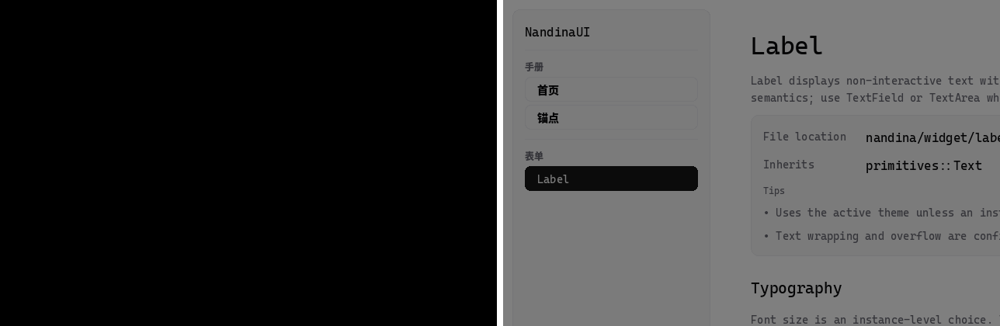
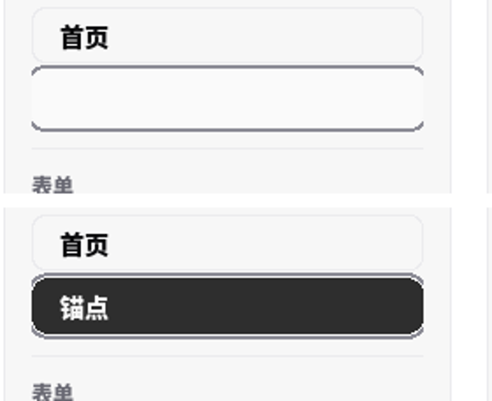

# 视觉回归：golden、容差与更新流程

> **状态：政策已定（2026-10-17），harness 未实施。** 本文规定"像素回归怎么建立预期、怎么比较、
> 谁能改 golden"。第一批落地对象是 [D7](reference_draft.md#d7-渲染质量与后端视觉一致性) 的
> 混合修复：按钮按下、涟漪中间态、Dialog 遮罩。

## 1. 为什么不能"每个后端存一张自己画出来的图"

那会把后端现存缺陷固化成预期：SDL 现在缺几何混合，如果 golden 直接取当前输出，"白底白字"就变成
"通过"。所以预期分两层：

| 验证层 | 预期来源 | 用途 | 典型对象 |
| --- | --- | --- | --- |
| 基础正确性 | **数学预期或独立参考值**（不取自任何后端） | 判断结果**是否对** | 半透明图元在已知背景上的合成色、平坦内部填充、裁剪边界 |
| 页面与固定交互帧 | **审核过的 golden** | 判断视觉**是否出现非预期变化** | 整页、按下态、涟漪中间态、Dialog 遮罩 |

第一层优先、且必须存在；没有第一层，"golden 通过"只能证明"和上次一样"。

## 2. 目录与清单

目标组织（不要求第一批就建全，先建实际用到的）：

```text
tests/golden/backend/
    manifest.toml        # 每个场景的采样条件、比较规则与特殊容差原因
    shared/              # 两条渲染路径都适用的场景
    sdl-basic/           # SDL CPU 几何路径
    sdl-sdf/             # SDL 生产 SDF 路径（批次 3 之后）
    raylib/              # 对照路径，仅用于已接受的可解释差异
```

- 放在 `tests/` 是因为 golden 是**可执行测试的预期结果**；`docs/images/` 是展示与历史证据，
  `playground/` 不承担正式回归依赖。
- **共享优先**；只有两条路径存在已接受、可解释的差异时才按路径分存。
- **不按 GPU 型号新增 golden**——那掩盖可移植性问题；驱动差异用容差与允许超限像素比例表达。

## 3. manifest 记录什么

比较器**只执行规则**，规则写在同目录的 `manifest.toml`：

| 类别 | 字段（示意） |
| --- | --- |
| 采样条件 | 场景名、视口尺寸、缩放、主题/外观、固定字体、动画采样时刻（帧号 + 固定 dt） |
| 渲染路径 | 后端、设备实现（CPU 几何 / SDF）、必要的生成环境信息 |
| 比较规则 | 比较区域（可多个矩形）、逐通道误差上限、允许超限像素比例 |
| 特殊容差 | 为什么这条场景比默认宽（例如字体栅格化、AA 边界），必须写原因 |

**禁止只看全图平均误差**：Dialog 遮罩、按钮边缘这类局部错误很容易被大面积背景稀释。混合测试的
平坦内部区域用独立预期 + 很小的舍入容差；字体与 AA 边界另设规则，不能共用一组数字。

具体数值在正常样本上定形，然后用**故障注入**验证它确实会失败（例如删掉混合设置那行、把状态层
alpha 改成 1）。

## 4. 更新流程

| 步骤 | 谁 | 规则 |
| --- | --- | --- |
| 比较 | CI / 测试 | **只比较，绝不自动接受新图**；失败时产出差异图与指标 |
| 再生 | 开发者或 AI | 执行显式再生命令，产出**候选图 + 差异图 + 指标**，不直接覆盖 |
| 批准 | 维护者 | 明确认可视觉变化后才替换受版本控制的 golden |
| 改容差 | 维护者 | 与改 golden 同等审批：写清原因，不能作为"让 CI 变绿"的手段 |
| 纯基础设施改动 | 维护者 | 原则上**不改** golden；确需改时必须解释预期视觉为何变化 |

当前由作者主导视觉体验，"作者审核候选结果、工具负责再生与比较"已经足够，不需要先做权限系统。

## 5. 第一批（D7 混合修复）：已落地

**测试**：`tests/sdl_visual_tests.cpp`，4 个用例 / 31 条断言，注册为 `unit` 套件里的
`sdl-visual` 目标（C++ 测试按仓库既有约定归 `unit`；`integration` 保留给 Python 与构建工作流）。

**为什么能确定性**：用 `SDL_CreateSoftwareRenderer(surface)` —— 不需要窗口、显示器或 GPU 驱动，
像素只由绘制调用与合成决定；期望值是**解析合成色**（8 位逐通道 `src*a + dst*(1-a)`，容差 ±2），
不取任何后端当前输出，因此没有 golden、也不受驱动差异影响。

| 用例 | 断言 |
| --- | --- |
| 半透明圆角矩形压在已知背景上 | 中心 == `over(bg, color@128)`；外部仍等于背景；且结果不同于"原色不透明" |
| 按下态 filled 按钮 | 中心 == `over(over(bg, fill), pressed_state_layer)`；前提断言状态层 alpha ∈ (0,255)；且不等于"状态层不透明" |
| 涟漪中间态（固定 dt 推进到 progress≈0.5） | 中心 == `over(over(over(bg, fill), state), ripple@alpha*(1-p))` |
| 对话框遮罩 | 中心 == `over(bg, scrim)`；前提断言 scrim alpha ∈ (0,255) |

**故障注入已执行**：删掉设备构造里的 `SDL_SetRenderDrawBlendMode(BLEND)` → 4 个用例全部变红；
还原后全绿。这是"改坏哪一行会让它红"的答案。

**GPU 路径的同一修复证据**（探针，真实窗口 + GPU renderer）：

| 场景 | 修复前 | 修复后 |
| --- | --- | --- |
| Dialog 遮罩下的整页亮度（mean） | 5.9（近黑，看不到背后内容） | 125.0（可透视） |
| 侧边栏选中项最暗行均值 / 行带标准差 | 156.9 / 32.1（白块，文字不可见） | 74.7 / 88.0（深色填充 + 白字） |





**仍未做的部分**：页面级"审核过的 golden"这一层。当前基础正确性层已经把"对错"钉住，页面级 golden
要等 §3 的 manifest 与 §4 的审批流程真正建起来；在那之前不提交 golden，避免把当前输出固化成预期。

**harness 规则已同步到探针**：`page_probe` 的读回移到了 `SDL_RenderPresent` 之前（超过 300 行前的
实践是 present 之后再读，曾经读到空帧）。

## 6. 与其它文档的关系

- 采样协议与性能阈值见[性能预算](performance_budget.md)（测量口径不同，不要混用同一份数字）；
- 后端能力差异与降级路径见[平台与后端契约](platform_backend_contract.md) §3；
- 逐图元 trace 只证明调用序列一致，**不证明像素正确**；trace 与像素各自证明自己的边界。
